  

  
  
  

  

## More projects

| Project | What it is | Links |
|---|---|---|
| **Giakaa CMS** | Full-stack CMS with PostgreSQL and MongoDB, SEO-aware rendering, XSS sanitisation | [Live](https://o8m-giakaa-cms.vercel.app) · [Code](https://github.com/Balama2520/o8m-giakaa-cms) |
| **Avr Shop** | E-commerce and AI assistant for farmers | [Live](https://avr-shop.netlify.app/) |
| **SAR image research** | YOLOv8 and denoising autoencoders, published at IEEE | [Paper](https://ieeexplore.ieee.org/document/11042387) · [Demo](https://huggingface.co/spaces/Balamaneesh2520/satellite) |

  

## Experience

**Full-Stack Developer Intern, IBM SkillsBuild** (IBM ICE, Aug to Oct 2025, remote)
Built a MERN automation dashboard for 15+ project metrics, deployed on AWS EC2 with Docker and GitHub Actions, and delivered the Smart Tasks PWA as the capstone.

**Research Assistant, AI and Computer Vision Lab** (SRMIST, Jan to Jun 2025)
Published IEEE research on SAR target detection and built a denoising pipeline over 5,000+ images.

## Open to work

Looking for Full-Stack or Associate Software Engineer roles in Bangalore, Hyderabad or remote.

📧 [abalamaneesh@gmail.com](mailto:abalamaneesh@gmail.com) · 💼 [LinkedIn](https://www.linkedin.com/in/bala-maneesh-ayanala-702582266/) · 🌐 [Portfolio](https://abms-portfolio.netlify.app)
